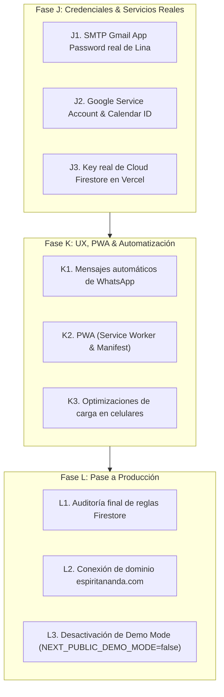

# 🤖 AGENTS.md — Guía del Proyecto & Protocolo de Desarrollo (AnandaStore V2)

**Proyecto:** AnandaStore V2 — Plataforma Holística, Citas Astrales & E-Commerce  
**Cliente / Marca:** Lina (Espíritu Ananda)  
**Rama Oficial Única:** `main` (Única rama activa en Git y GitHub)  
**Repositorio:** `diegoillers-ux/storebasc`  
**Despliegue Único:** `https://storebasc.vercel.app` (Vercel Preproducción)  

---

## 🏛️ 1. Resumen de Arquitectura y Estado Actual

El proyecto ha sido refactorizado y estandarizado al 100% en la versión 2.0. El estado actual de la plataforma comprende:

| Capa | Tecnología / Configuración | Función |
| :--- | :--- | :--- |
| **Framework** | Next.js 16.1 (App Router + Turbopack) | Renderizado SSR/ISR, Server Actions y API Routes |
| **Estilos & UI** | Tailwind CSS v4 + PostCSS | Paleta `--color-ananda-*`, tarjetas glassmorphism, responsive móvil |
| **Base de Datos** | Firebase Cloud Firestore | Base de datos NoSQL serverless (repositorios en `src/lib/firebase/repositories/`) |
| **Backend Admin** | Firebase Admin SDK (`firebase-admin`) | Patrón repositorio seguro en endpoints backend |
| **Autenticación** | NextAuth v5 (Beta 29) + Google OAuth | Doble flujo: Google OAuth 2.0 y Botón `⚡ Ingreso Directo Admin (Preproducción)` |
| **Agendamiento** | Google Calendar API | Verificación de franjas horarias libres/ocupadas |
| **Correos** | Nodemailer (SMTP / Gmail) | Plantillas HTML automáticas para recibos y confirmaciones |
| **Tareas Cron** | Vercel Cron (`/api/cron/cleanup`) | Liberación de citas reservadas no pagadas (>30 min) |

---

## 📁 2. Estructura de Directorios Estandarizada (`main`)

```
storebasc/
├── docs/                           # Documentación oficial y checklists activos
│   ├── PROJECT-MANUAL-V2.md        # Manual técnico definitivo y esquemas NoSQL
│   ├── QA-E2E-CHECKLIST.md         # Matriz de evaluación End-to-End (PASS)
│   ├── BUGS-FOUND.md               # Bitácora de hallazgos y correcciones P0/P1
│   └── VERCEL-VARIABLES-GUIDE.md   # Matriz limpia de variables de entorno de Vercel
├── public/                         # Assets estáticos (logotipos, favicons)
├── src/
│   ├── app/                        # Rutas de Next.js (App Router)
│   │   ├── (admin)/admin/          # Panel administrativo único protegidos (/admin/*)
│   │   ├── (public)/               # Portada pública comercial y catálogo (/servicios, /tienda)
│   │   ├── api/                    # API Routes backend (bookings, orders, availability, cron)
│   │   ├── checkout/               # Embudos de pago (3 pasos para citas, 4 pasos para tienda)
│   │   └── login/                  # Pantalla de inicio de sesión con doble acceso (Demo/Google)
│   ├── components/                 # Componentes UI reutilizables
│   │   ├── admin/                  # Sidebar, Topbar, visores zoom de recibos
│   │   ├── public/                 # AvailabilityCalendar, CartDrawer, ProductCard, ServiceCard, Header, Footer
│   │   └── ui/                     # Alertas, modales, loaders
│   ├── context/                    # CartContext global de e-commerce
│   └── lib/                        # Lógica de negocio y repositorios de datos
│       ├── firebase/               # Conexión Firestore y repositorios NoSQL
│       ├── auth.ts                 # Configuración de NextAuth v5
│       ├── demoMode.ts             # Helper de modo dual (Demo vs Producción Real)
│       └── googleCalendar.ts       # Integración con Google Calendar SDK
├── .env.example                    # Plantilla oficial de variables de entorno
├── .env.local                      # Variables locales de desarrollo/preproducción
├── .firebaserc                     # Vinculación de proyecto Firebase (`nexo-celestial-final`)
├── AGENTS.md                       # Este documento de referencia para agentes AI y desarrolladores
├── firebase.json                   # Reglas e índices de despliegue Firebase CLI
├── firestore.rules                 # Reglas de seguridad NoSQL
├── next.config.ts                  # Configuración Next.js y redirecciones
├── seed-catalog.mjs                # Script de siembra inicial de productos y servicios
├── seed-firebase.mjs               # Script de siembra inicial de clientes y reservas
├── seed-mail.mjs                   # Script de siembra inicial de configuraciones SMTP
├── tailwind.config.ts              # Tokens de diseño místico y paletas Ananda
└── vercel.json                     # Configuración de despliegue Vercel y Cron
```

---

## 🚫 3. Reglas Inviolables del Proyecto

1. **Rama Única (`main`)**:
   - Todo el trabajo debe ser realizado y commiteado directamente sobre la rama `main`.
   - **NO crear ni subir ramas secundarias** a GitHub (`origin`).
2. **Sin Código ni Documentos Legados u Obsoletos**:
   - Queda prohibido reintroducir carpetas legadas fuera de las estructuras `(public)` y `(admin)` (como la antigua carpeta `src/app/admin/reservas`).
   - Toda documentación debe ser mantenida exclusivamente en `docs/` y sincronizada con el estado real del código.
3. **Seguridad y Secretos**:
   - NUNCA commitear archivos `.env`, `.env.local` ni claves privadas PEM.
   - Las escrituras en Firestore están restringidas al servidor mediante `firebase-admin` (`allow write: if false` en `firestore.rules`).
4. **Respetar Modo Dual de Operación**:
   - `NEXT_PUBLIC_DEMO_MODE="true"` permite probar y evaluar la aplicación sin requerir credenciales reales de Google Cloud o Firebase en preproducción.

---

## 🚀 4. Propuesta de Plan de Trabajo para las Fases Siguientes (J, K, L)

> [!IMPORTANT]
> **ESTE PLAN ESTÁ PLANIFICADO Y LISTO PARA EJECUCIÓN FUTURA. NO INICIAR LAS FASES HASTA INDICACIÓN EXPRESA DEL USUARIO.**



### 📋 Detalle de Fases Planificadas:

#### **Fase J — Integraciones & Credenciales Reales (Lina)**
- **J1. Configuración SMTP Real**: Reemplazar las variables `SMTP_USER` y `SMTP_PASSWORD` con las credenciales de aplicación de Gmail de Lina para enviar correos transaccionales reales.
- **J2. Google Calendar API de Producción**: Vincular el email personal de Lina (`NEXT_PUBLIC_CALENDAR_ID`) con una Service Account de Google Cloud para el agendamiento directo en su agenda personal.
- **J3. Firebase Service Account Key**: Configurar `FIREBASE_SERVICE_ACCOUNT_KEY` en el panel de Vercel para conectarse al proyecto Firestore de producción real.

#### **Fase K — Experiencia de Usuario, PWA & Automatizaciones**
- **K1. Automatización WhatsApp**: Implementar redirección inteligente con mensaje prediligenciado que contenga el resumen de la cita/pedido directamente al número de WhatsApp de Lina.
- **K2. Configuración PWA**: Crear `manifest.json` y `service-worker.js` con soporte offline e instalación en pantalla de inicio para Android e iOS.
- **K3. Rendimiento Móvil**: Optimización de imágenes en formatos WebP/AVIF y lazy loading en dispositivos móviles de gama media/baja.

#### **Fase L — Pase a Producción & Lanzamiento Comercial**
- **L1. Auditoría de Seguridad**: Verificación final de reglas NoSQL en `firestore.rules` e índices compuestos en `firestore.indexes.json`.
- **L2. Dominio Personalizado**: Asignar y certificar SSL para `espiritananda.com` en Vercel.
- **L3. Conmutación a Producción Real**: Cambiar `NEXT_PUBLIC_DEMO_MODE="false"` y retirar el acceso demo de la pantalla de login.
